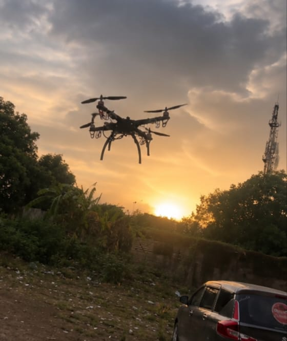
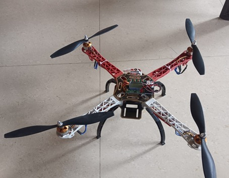
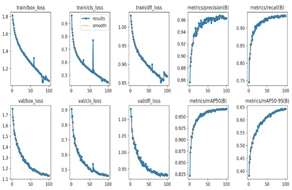
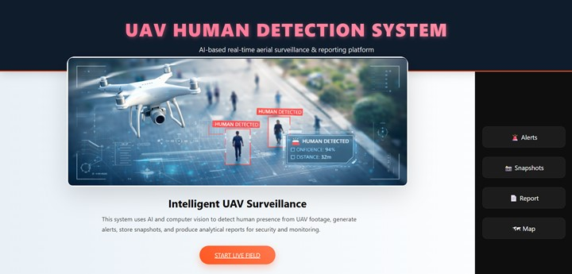
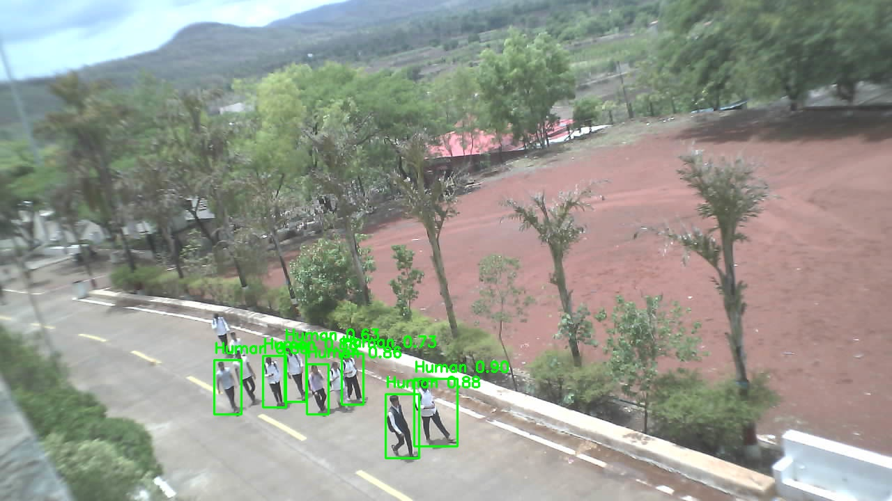
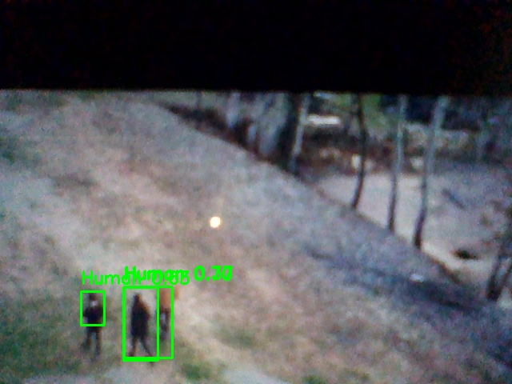

# AI-Powered Real-Time Human Detection from UAV Using YOLOv8

An intelligent UAV-based human detection and monitoring system powered by YOLOv8, Computer Vision, Python, and Flask. The system processes live video streams from an ESP32-CAM and detects humans in real time, providing visual monitoring, alert generation, and a web-based dashboard.

---

## Project Overview

This project focuses on developing an AI-powered surveillance solution using an Unmanned Aerial Vehicle (UAV). It integrates a YOLOv8 object detection model with a live camera feed to identify humans and monitor detection activity through a centralized web dashboard.The system is designed to support real-time monitoring, automated alerts, and visual evidence collection.

---

## 🎯 Objectives

- Detect humans from aerial drone images and videos.
- Develop a YOLOv8s-based human detection model.
- Integrate an ESP32-CAM for real-time video acquisition.
- Perform deep learning inference on a ground station.
- Reduce onboard computational requirements.
- Generate alerts when humans are detected.
- Record detection events and save snapshots for analysis.

---

## Key Features

-Real-Time Human Detection: Detects humans from live camera streams using YOLOv8.
-UAV-Based Monitoring: Integrates an ESP32-CAM video stream for aerial surveillance.
-Live Video Processing: Processes incoming video frames and displays detection results.
-Intelligent Alert System: Generates alerts based on the number of detected humans.
-Web-Based Dashboard: Provides a centralized interface for monitoring detection activity.
-Snapshot Management: Captures and stores detection snapshots.
-Alert History: Maintains detection records in a CSV file.
-Detection Reports: Provides access to monitoring reports and historical activity.

---

## 🏗️ System Architecture

The proposed system follows an offboard processing architecture.

1. The drone captures aerial video using the ESP32-CAM.
2. The video is transmitted over Wi-Fi.
3. The video stream is received by a ground station/laptop.
4. YOLOv8s processes incoming frames.
5. Humans are detected and highlighted using bounding boxes.
6. Detection events generate alerts.
7. Detection timestamps and snapshots are stored.

---

## 🚁 Hardware Setup

The UAV consists of a custom-built quadcopter platform equipped with:

- Quadcopter frame
- Brushless DC motors
- Electronic Speed Controllers (ESCs)
- KK2.1.5 flight controller
- Radio transmitter and receiver
- Li-Po battery
- DC-DC buck converter
- ESP32-CAM module

---

### Actual Drone Hardware

*Custom-built UAV used for the proposed human detection system.*

---

## 📂 Dataset

Two publicly available aerial human detection datasets were combined to create a diversified training dataset.

- Manipal UAV Dataset
- SARD Dataset

---

### Dataset Preparation

- Dataset fusion and consolidation
- Duplicate filename conflict resolution
- YOLO-format bounding-box annotations
- Scale-aware bounding-box height filtering
- Removal of extremely small human annotations
- Dataset partitioning into training, validation, and testing subsets

---

## 🧠 Model Information

| Parameter | Details |
|---|---|
| Model | YOLOv8s |
| Task | Object Detection |
| Target Class | Human |
| Number of Classes | 1 |
| Input Image Size | 640 × 640 |
| Epochs | 100 |
| Optimizer | SGD |
| Initial Learning Rate | 0.01 |
| Batch Size | 4 |
| Training Platform | Google Colab |
| GPU | NVIDIA T4 |

---

| Dataset Split | Percentage |
|---|---:|
| Training | 80% |
| Validation | 10% |
| Testing | 10% |

**Total curated dataset: 7,358 images**

---

## 📊 Model Performance

The trained model achieved the following performance:

These results demonstrate the model's ability to detect humans in aerial images with strong precision and recall.

---

## 🖥️ Real-Time Detection Dashboard

An integrated dashboard was developed for monitoring human detection events.he integrated dashboard provides a centralized interface for real-time UAV-based human detection and monitoring. It displays the live video feed with YOLOv8-based detection results, highlights detected humans using bounding boxes, and generates alerts whenever human presence is detected.

---

## 🔍 Detection Results

The trained YOLOv8s model was tested on aerial images and external images. Detected humans are highlighted with bounding boxes.

*Human detection results on external aerial images.*

---

## 🛠️ Technologies Used

- Python
- YOLOv8
- Ultralytics
- Deep Learning
- Computer Vision
- OpenCV
- ESP32-CAM
- Wi-Fi Video Streaming
- Google Colab
- PyTorch

---

## 🌍 Applications

- Search-and-rescue operations
- Disaster response
- Aerial surveillance
- Human presence detection
- Monitoring inaccessible areas
- Emergency response support

---

## 🔮 Future Improvements

- GPS module integration for real-time UAV location tracking
- Geo-tagging of human detection events
- Improved wireless communication range
- Increased battery capacity
- Improved flight endurance
- Further testing under different environmental conditions

---

## 📄 Research Paper

**An Offboard Intelligent System for Real-Time UAV-Based Human Detection**

This project is based on research involving UAV aerial human detection, dataset fusion, scale-aware bounding-box filtering, YOLOv8s training, and real-time offboard inference.

---

⭐ If you find this project interesting, feel free to star
